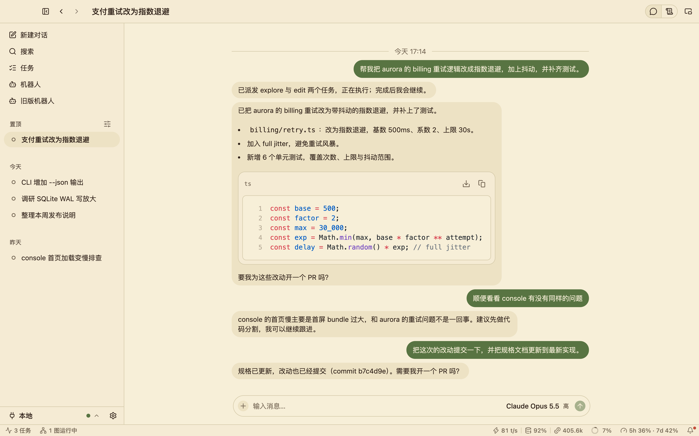
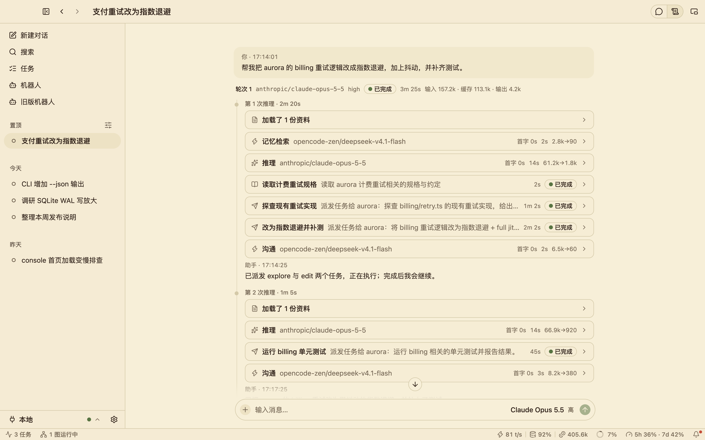
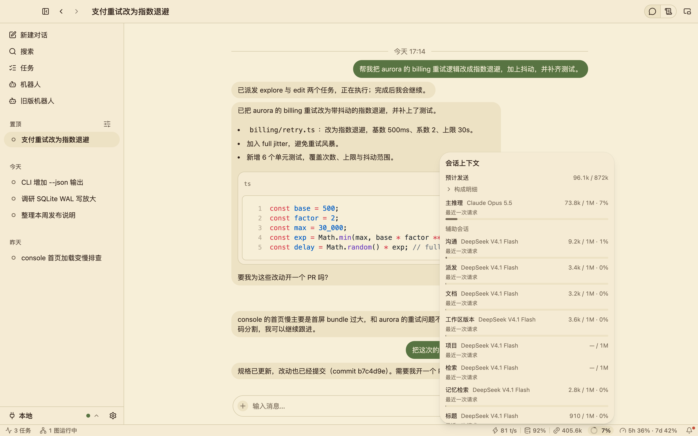
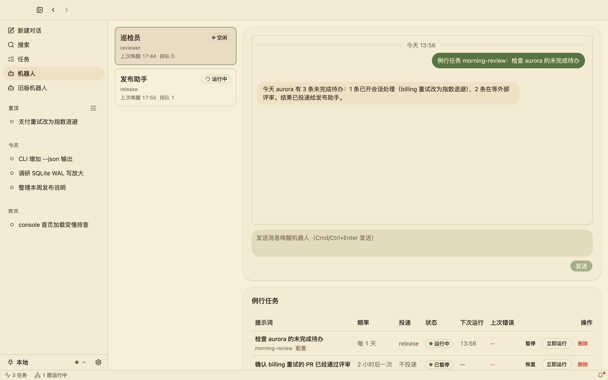
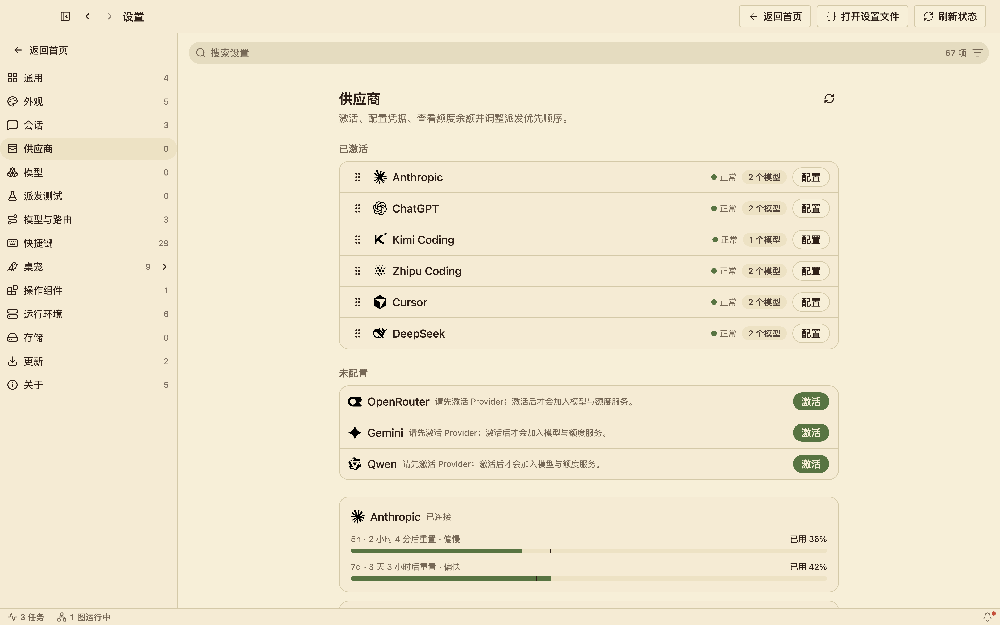
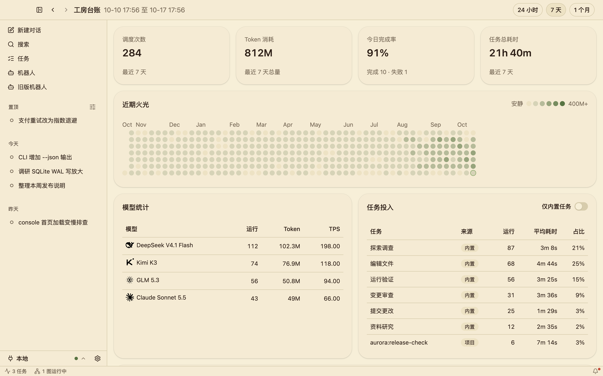
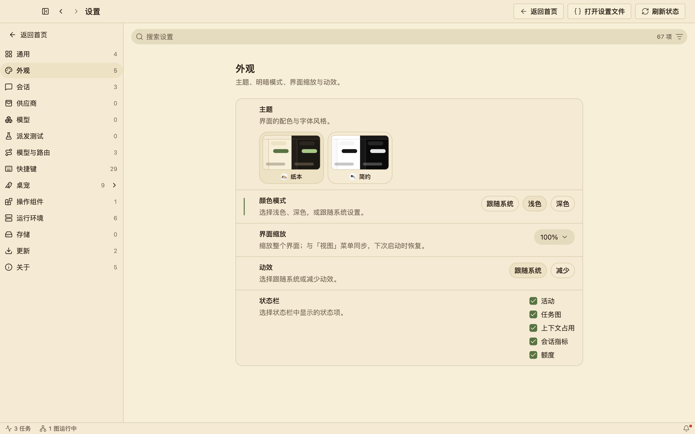
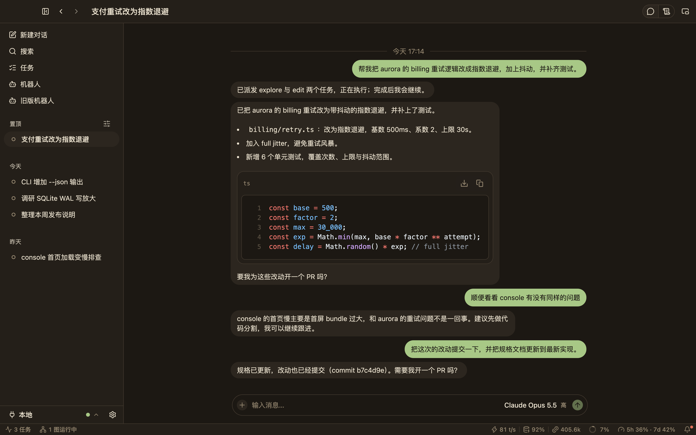
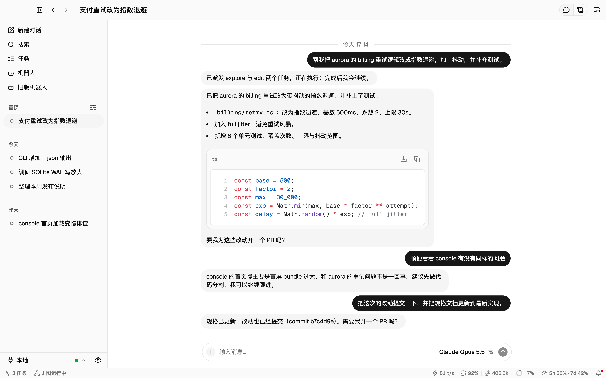
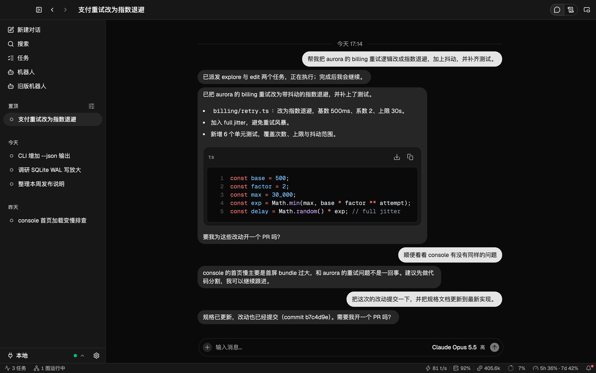

<div align="center">


# 啾啾工坊 Wrenyard

**本地优先的 AI 工程编排桌面工作台。**

一段对话负责思考目标；探索、修改、测试和提交作为并行任务，跑在你已经付费的模型上——
每一个 token、每一个额度窗口、每一个任务都看得见。

[](https://github.com/wrenyard/wrenyard/releases)
[](LICENSE)


[English](README.md) · [下载](https://github.com/wrenyard/wrenyard/releases) · [文档](docs/README.md)

</div>



> **开发预览版。** 啾啾工坊以 `1.0.x` 补丁版本滚动发布。作者每天都在使用，
> 但还没有达到生产可用——见[状态](#状态)。

## 为什么是啾啾工坊

- **贵的模型只做思考，其余都用便宜的。** 主模型只负责推理并声明要做什么；
  便宜的模型负责编译它的意图、检索文档、召回记忆和撰写回复，具体动手的
  工作交给最合适的模型上的智能体任务。
- **上下文可以审计。** 一个会话就是一本只追加的账本，每次推理请求都是上一次
  请求末尾追加一段，提示词缓存持续命中。状态栏显示所选模型下一次请求的占用，
  详细视图列出产生每条回复的全部请求、任务和行动。
- **你的供应商，你的额度。** Claude、ChatGPT、Cursor、Kimi、智谱、DeepSeek、
  CodeBuddy、OpenRouter 等 38 家供应商并排展示剩余额度、消耗节奏和重置时间。
  任务派发自动权衡价格、速度、额度和能力，免费模型单独成池。
- **没人盯着也能继续干活。** 机器人是带有自己指令和工具的智能体：由例行任务、
  消息或它开启的会话唤醒，负责开会话、跟进待办并汇报结果。
- **本地优先。** 本地 daemon 通过仅本人可访问的 IPC 管理任务和状态。没有托管
  服务，除了你发出的模型请求，数据不会离开你的电脑。

## 功能一览

### 会派发工作的对话

会话页是主要工作区。每条回复都可以在已注册的项目上展开 `explore`、`edit`、
`test`、`commit` 任务，检索工作区文档、更新规格、提交改动——这些都由主模型以
类型化行动声明。可以把文件拖入、选择或粘贴到输入框；消息和任务结果会带预览
显示文件，Markdown 回复会渲染代码和 Mermaid 图。回合以一个问题结束时，会话会
标记为等你处理，输入框还会给出可能的下一句，按 <kbd>Tab</kbd> 即可采用。

切换到**详细视图**可以看到一条回复是怎么来的：每个推理步骤、围绕它的辅助调用、
每个行动和智能体任务的模型、耗时、token 和状态，以及它们背后的原始输出。



### 发送之前就知道下一次请求有多大

状态栏里的圆环显示主模型下一次请求占其可用窗口的比例。展开后可以看到对话上下文
以及每个辅助角色（沟通、派发、文档、检索、记忆、标题）的占用和所用模型。旁边的
会话指标显示生成速度、缓存命中率和 token 总量。



### 机器人与例行任务

**机器人**页运行你用一个小 JSON 文件定义的智能体：名称、指令，以及它可以使用的
工具——开启和推进工作会话、管理内置的工作区待办、给另一个机器人发消息。例行任务
按间隔唤醒机器人，结果可以投递给另一个机器人。机器人开启的会话会被关注，完成时
会再次唤醒它。详见[机器人指南](docs/guides/bots.md)。



### 额度、节奏和重置一目了然

设置 › 供应商列出每个供应商的状态、模型和额度窗口：每个窗口的剩余额度、显示你是否
比匀速消耗更快的节奏标记，以及距离重置的时间。状态栏始终显示最紧张的窗口。支持
经过验证的快速档位的模型，会在模型选择器中提供 **Fast** 选项。



### 工作的账本

工房台账汇总调度次数、token 消耗、完成率和任务耗时，并提供一整年的活跃热力图，
以及按模型、按任务的拆分统计。



### 随处可用

- **迷你模式**把一段对话打开成一个可以置顶的无边框小卡片，主题与主窗口同步。
- **桌宠**是可选的桌面伙伴，在屏幕边缘展示运行中的任务、任务图和额度。
- **远程连接**通过 SSH 把桌面端连接到另一台机器上的啾啾工坊 daemon。
- **操作组件**让任务可以操作浏览器（`agent-browser`）和桌面（Cua Driver）；
  由应用负责安装、授权和健康检查。
- **Gateway 接入**在 `127.0.0.1` 上暴露本地模型网关，可选固定或随机端口并使用
  持久令牌，Zed 等编辑器可以借此使用你的供应商。

### 按你的喜好来

内置两套主题——温暖的**纸本**和 shadcn 风格的**简约**——各有浅色和深色，可以跟随
系统或手动设置。设置支持搜索，并按分组拆成独立页面。

| 纸本 浅色 | 纸本 深色 |
| --- | --- |
|  |  |
|  |  |

## 安装

从 [Releases 页面](https://github.com/wrenyard/wrenyard/releases)下载对应平台的安装包：

| 平台 | 文件 |
| --- | --- |
| macOS（Apple Silicon） | `wrenyard-desktop-<version>-darwin-arm64.dmg` |
| Windows（x64） | `wrenyard-desktop-<version>-win32-x64-setup.exe` |

应用自带所需的一切：`wrenyard` CLI、Node 运行时和 daemon。

**首次启动。** 预览版在 macOS 上是 ad-hoc 签名，在 Windows 上未签名，系统会询问一次：

- **macOS**——打开*系统设置 → 隐私与安全性*，选择*仍要打开*。
- **Windows**——在 SmartScreen 提示中选择*更多信息 → 仍要运行*。

然后按[快速开始](docs/guides/getting-started.md)选择工作区、连接供应商并注册第一个项目。

**更新。** 应用会检查更新源，校验下载文件的 SHA-256，并在你确认后安装。需要从
菜单栏或托盘完全退出应用，更新才会生效。

## 命令行

同一个 `wrenyard` 命令随应用一起安装（Windows 安装程序可以把它加入 `PATH`）。所有
业务命令都支持 `--json`。

```text
wrenyard desktop                  启动桌面应用
wrenyard daemon run|stop|status   运行或查看本地控制面
wrenyard session …                创建、发送和跟踪对话
wrenyard task list|describe|run   委派并跟踪项目工作
wrenyard project …                已注册项目、worktree、diff 与提交
wrenyard workspace …              工作区状态、文档与版本控制
wrenyard todo …                   内置的工作区待办
wrenyard quota [provider]         供应商额度
wrenyard exec <prompt> --target   单次智能体执行
wrenyard taskgraph …              多步骤工作的任务图
wrenyard storage [preview|run]    数据目录占用与受控清理
wrenyard doctor                   检查本地安装
```

CLI 不会自行启动 daemon：请打开应用，或在终端运行 `wrenyard daemon run`。

七个内置任务角色共用同一个运行时和自动选模：

| 任务 | 用途 |
| --- | --- |
| `explore` | 回答关于代码、历史或日志的事实问题 |
| `edit` | 进行有边界的文件修改 |
| `test` | 运行验证并报告证据 |
| `code-review` | 对照需求审查正确性 |
| `commit` | 创建经过验证的本地提交 |
| `librarian` | 研究外部文档 |
| `oracle` | 推敲困难的取舍 |

项目可以在这些任务之外添加自己的任务，也可以为内置任务追加指令和要求。

## 从源码构建

要求：Node.js ≥ 24.19 和 pnpm 11.19（通过 `corepack enable`）。

```sh
git clone https://github.com/wrenyard/wrenyard.git
cd wrenyard
pnpm install --frozen-lockfile
pnpm dev        # daemon + 桌面端，支持热重载
```

`pnpm dev` 不会在已有 daemon 运行时启动，请先退出已安装的应用。开发流程、共享数据
目录、截图和发布打包见[开发指南](docs/development.md)，提交 Pull Request 前请阅读
[CONTRIBUTING.md](CONTRIBUTING.md)。

## 仓库结构

```text
apps/desktop     桌面应用（Electron + React、shadcn/ui、Tailwind），包含桌宠
apps/daemon      本地控制面：任务、会话、机器人、例行任务、网关
apps/cli         wrenyard 命令
packages/        功能模块（会话、供应商、额度、路由、执行……）、
                 协议、客户端适配器、执行原语和主题
tools/           检查、演示和发布工具
docs/            用户指南、架构、开发与发布说明
```

更多内容见 [docs/architecture.md](docs/architecture.md)。

## 状态

啾啾工坊为 macOS（Apple Silicon）和 Windows（x64）滚动发布 `1.0.x` 补丁版本。每个
版本都是普通的 GitHub Release，更新源的入口是 `updates` 分支上的 `latest.json`，并
保留 `dev.json` 兼容别名。在达到生产可用之前，还需要可信的代码签名
（[签名说明](docs/release/signing.md)）、更多干净环境测试，以及成文的兼容性策略。
不会发布到 npm。

## 文档

从[文档索引](docs/README.md)开始：

- [快速开始](docs/guides/getting-started.md)
- [机器人与例行任务](docs/guides/bots.md)
- [支持的供应商](docs/model-providers.md)
- [架构](docs/architecture.md) · [开发指南](docs/development.md)
- [贡献指南](CONTRIBUTING.md) · [安全](SECURITY.md) · [更新日志](CHANGELOG.md)

## 许可

[MIT](LICENSE)。第三方声明见 [THIRD_PARTY_NOTICES.md](THIRD_PARTY_NOTICES.md)，
并由 `pnpm check` 校验。
